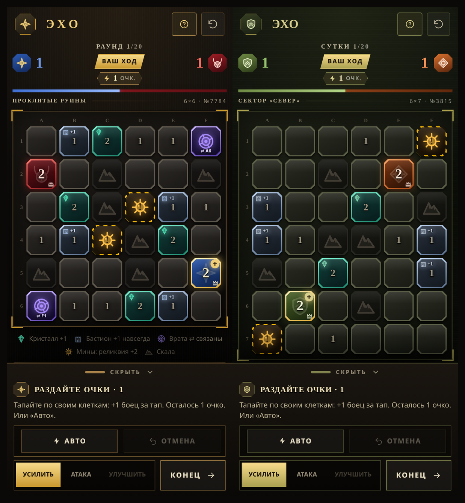
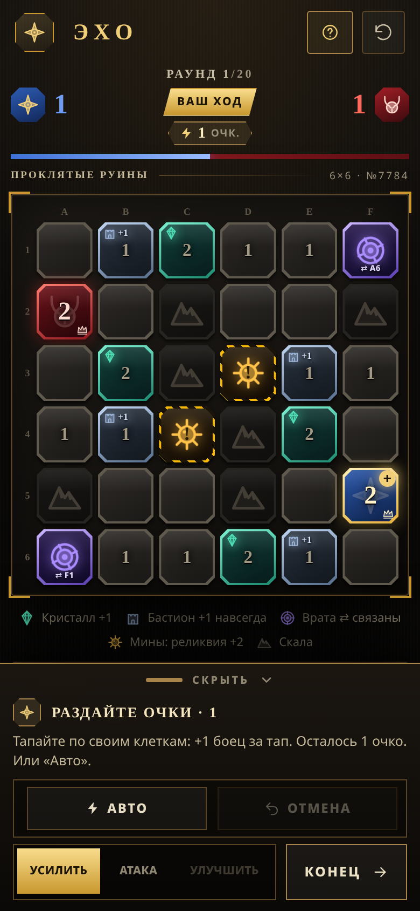
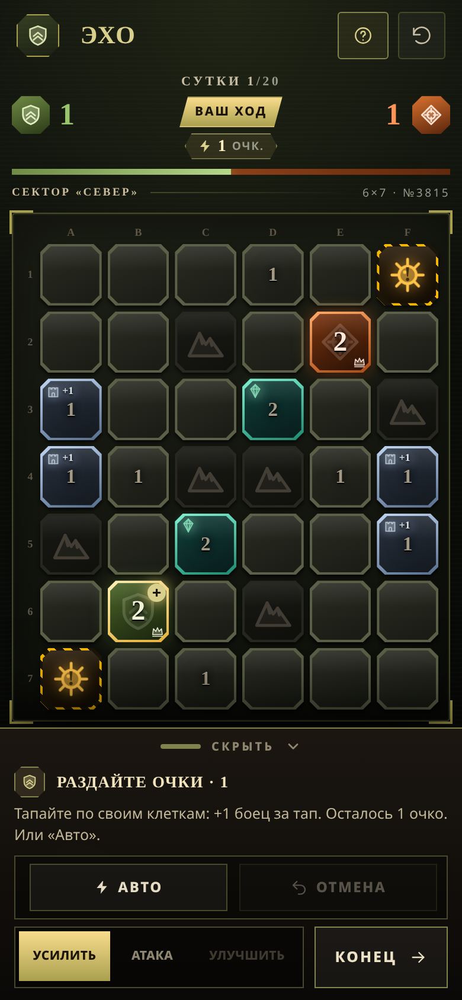

# ЭХО

Пошаговая стратегия на клетчатом поле, целиком работающая в браузере. Партия короткая: максимум 20 ходов, обычно меньше.

Главная особенность — **два сеттинга на выбор**. Одна и та же игра, но с разной войной: либо тёмное фэнтези «свет и тьма», либо вымышленный современный фронт. Меняется не только оформление, но и весь язык игры: названия клеток, построек, ходов и противника.



*Слева — «Свет и тьма». Справа — «Современный фронт».*

---

## Как играть

**Цель.** Захватить все клетки противника — победа сразу. Если за 20 ходов никто никого не добил: побеждает тот, у кого больше клеток; при равенстве клеток — у кого больше бойцов; при полном равенстве — ничья.

**Число в клетке — это бойцы.** Максимум 9 в одной клетке. Обе стороны начинают с одной клетки и 2 бойцов.

**Ход.** Каждый ход вы получаете очки и тратите их:
- **Усилить** — тапнуть свою клетку и добавить бойца. Очко за бойца.
- **Улучшить** — построить на клетке постройку (см. ниже).
- **Атака** — тапнуть свою клетку с 2+ бойцами, затем соседнюю цель. Атакующий отряд оставляет дома одного бойца, остальные идут в бой.

**Бой.** Сила атакующих против защиты цели (бойцы + бонусы от укреплений):
- больше — захват;
- меньше — атака отбита, отряд гибнет;
- **ровно — монета 50/50**: отдельный экран, орёл — захват, решка — гибель отряда.

**Клетки на карте.**

- ✦ **источник дохода** — приносит +1 очко каждый ход.
- ▣ **укрепление** — даёт защитнику +1 и остаётся на клетке, даже когда её захватят.
- ⇄ **проход** — две далёкие клетки считаются соседними; значок показывает, куда он ведёт.
- ▲ **непроходимая клетка** — через неё не пройти.
- ◎ **заминированная клетка** — атака в неё запускает мини-игру «сапёр» (поле 4×4, три мины, первый ход всегда безопасен). Разминировали — клетка становится **особой точкой** и даёт +2 очка каждый ход. Ошиблись — весь отряд гибнет на месте.

**Постройки.** Одно улучшение на клетку, ставится за очки. Всё построенное **остаётся на клетке при захвате** — вместе с клеткой переходит и постройка:

- **Стена** — 2 очка, +1 к защите;
- **Казарма** — 3 очка, каждый ход приносит в эту клетку одного бойца;
- **Кузница** — 4 очка, +1 очко каждый ход.

Захватили чужую кузницу — её доход теперь ваш.

**Кнопка «Отмена»** снимает последнее вложение (бойца или постройку) и возвращает очки.

**Карта каждый раз новая:** размер 6×6, 6×7 или 7×7, рельеф, проходы, мины и позиции баз расставляются заново. Карта всегда симметрична относительно центра, чтобы у сторон были равные шансы.

**Два противника на выбор** (в меню новой партии):

- *Спокойный* — осторожный, иногда ошибается, не рискует на монете. Для знакомства.
- *Жёсткий* — считает ходы, строит кузницы и стены, охотится за особыми точками, идёт на 50/50, когда ему выгодно.

## Два сеттинга

Выбираются в меню перед началом партии, там же можно поменять противника. Правила в обоих одинаковые, отличаются только слова и цвета.

| Что это | «Свет и тьма» | «Современный фронт» |
|---|---|---|
| Противник | Тьма | Противник |
| Ход | Раунд | Сутки |
| Очки | Очки усиления | Очки подкрепления |
| Источник дохода | Кристалл | Склад |
| Укрепление | Бастион | Укрепрайон |
| Проход | Врата | Тоннель |
| Заминированная клетка | Мины | Минное поле |
| Особая точка | Реликвия | Высота |
| Непроходимая клетка | Скала | Завал |
| Защита | Стена | Окопы |
| Приток бойцов | Казарма | Резерв |
| Приток очков | Кузница | Тыл |




---

## Способы установки и запуска

Есть три пути. Первый — если хочется просто играть. Второй и третий — для работы с исходниками.

### Вариант 1. Играть сразу, без установки

В папке `release/` лежит **готовый файл** `Eho_war_v2.01_f.html` — вся игра целиком внутри одного файла. Ничего ставить не нужно.

- **На компьютере:** дважды кликнуть по файлу — откроется в браузере.
- **На телефоне:** отправить файл себе в мессенджер или перекинуть по кабелю, скачать и открыть. Дальше в меню браузера можно выбрать «Добавить на главный экран» — игра будет запускаться без адресной строки, как приложение.

Работает офлайн. Единственное, что тянется из интернета, — два шрифта Google; без сети игра всё равно запустится, просто шрифты будут системные.

### Вариант 2. Запуск из исходников (для правок)

Нужен **Node.js версии 20.19 или новее** (либо 22.12 и новее). Проверить:

```bash
node -v
```

Если версия старее или команда не найдена — установить Node.js с [nodejs.org](https://nodejs.org) (кнопка LTS).

Дальше из папки с проектом:

```bash
npm install     # установить зависимости, нужен интернет, делается один раз
npm run dev     # запустить игру
```

Терминал напишет адрес — обычно **http://localhost:5173**. Правки в файлах подхватываются сразу, пересобирать вручную не нужно. Остановить — `Ctrl + C`.

### Вариант 3. Сборка одного файла

```bash
npm run build
```

Готовый файл появится в `dist/index.html`. Это такая же самодостаточная сборка, как та, что лежит в `release/`: код, стили и вся графика внутри одного HTML. Его можно открывать где угодно или положить в `release/` вместо старого.

```bash
cp dist/index.html release/Eho_war_v2.01_f.html
```

---

## Структура проекта

```
index.html                  оболочка страницы, заголовок, настройки для мобильных
package.json                зависимости и команды
vite.config.ts              настройки сборки (в том числе «собрать всё в один файл»)
src/game.ts                 правила игры: карта, ходы, бой, экономика, ИИ
src/theme.ts                слова для двух сеттингов — тексты и названия
src/App.tsx                 экран игры: поле, панель, режимы, меню
src/Tile.tsx                одна клетка поля
src/Coin.tsx                экран броска монеты
src/Minesweeper.tsx         мини-игра «сапёр» для разминирования
src/Tutorial.tsx            обучение (7 шагов)
src/icons.tsx               иконки
src/index.css               оформление обоих сеттингов
release/                    готовый файл игры для телефона и ПК
docs/                       скриншоты
```

Правила живут в `src/game.ts`, тексты — в `src/theme.ts`. Этих двух файлов хватает почти для любой правки.

## Как добавить свой сеттинг

Всё уже подготовлено: в `src/theme.ts` лежат два словаря (`gothic` и `front`), каждый — просто набор строк.

1. Скопировать любой словарь и переименовать, например в `space`.
2. Переписать строки: как называется противник, ход, очки, клетки, постройки, что писать при победе и поражении.
3. Указать род противника: `fem: true` — «тьма захватила», `fem: false` — «противник захватил». От этого зависит грамматика во всех сообщениях.
4. Добавить словарь в объект `THEMES` в конце файла.
5. При желании добавить цвета в `src/index.css` по образцу блока `.theme-front`.

Логику трогать не нужно: игра сама подставит нужные слова.

## Частые вопросы

**Сборка падает с ошибкой про Node.** Версия Node старее 20.19. Обновите Node.js и попробуйте снова.

**Хочу просто играть, а не собирать.** Возьмите готовый файл из `release/` — он уже собран.

**Поле каждый раз разное, это нормально?** Да, так задумано: карта генерируется заново и всегда симметрична.

**Где взять версию, из которой это выросло?** В папках `eho_warhanmer` и `eho_warV2` лежат предыдущие шаги — там была одна тема и не было построек.

**Нужен ли интернет для игры?** Нет. Игра полностью локальная.
